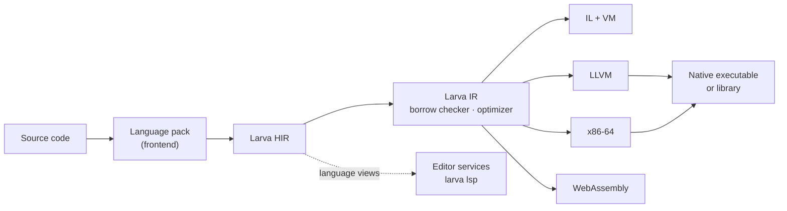

<p align="center">
  
</p>

<h1 align="center">Larva</h1>

<p align="center">
  <strong>One toolchain for many languages: compiler back ends, build tool, package manager and language server behind a single command.</strong>
</p>

<p align="center">
  <a href="#quick-start">Quick start</a> ·
  <a href="#architecture">Architecture</a> ·
  <a href="#the-larva-command">CLI</a> ·
  <a href="#building-from-source">Building from source</a> ·
  <a href="#repository-layout">Layout</a>
</p>

---

Larva is a language-independent compiler toolchain. A language plugs into Larva as a **language pack**: it turns its source into Larva's high-level IR (HIR). Larva then provides everything else: type checking services, optimization, code generation for native code, WebAssembly and a portable VM, plus memory management, projects, packages, native-library bindings and editor support.

## Highlights

- **Several back ends from one IR.** It compiles to native executables through LLVM or through Larva's own x86-64 code generator. It also targets WebAssembly, either directly or through LLVM, and a portable bytecode VM.
- **Memory management chosen per project.** Tracing GC, reference counting, arenas, manual memory, or a collector you write yourself. Projects with different collectors link into one program, and the boundary between them is checked.
- **Projects without boilerplate.** A small `.queen` file describes a project's build, dependencies, files and resources. `larva run` rebuilds only what changed.
- **Hive, the package manager.** It handles signed packages, semantic version ranges, a local cache and publishing from the command line.
- **Native bindings.** It reads a DLL's or shared object's exports, or a C header, and generates typed bindings. Structs, unions, callbacks and constants are supported, and binding profiles let you shape the result.
- **Editor support for every language at once.** `larva lsp` is a Language Server Protocol server that serves every installed language pack. It reports diagnostics as you type, offers completion, hover and go-to-definition, and shows decompiled views of library types.
- **A borrow checker.** References can be enforced, reported as warnings, or turned off, for each project.
- **Signed language packs.** Larva checks a pack's signature and files before it loads it.

## Quick start

Installers for Windows, Linux and macOS are published on the [Releases](https://github.com/Antril-Organization/Larva/releases) page. Until the first release is out, [build Larva from source](#building-from-source). Then check it from a new terminal:

```shell
larva --version
larva languages          # the language packs installed, verified
```

Create a project from a template, then build and run it:

```shell
larva new                          # list the templates
larva new Console-App Hello --lang <language>
cd Hello
larva run
```

Build the same project for other targets:

```shell
larva build -O3                          # native executable (LLVM)
larva build --backend x64                # native executable (Larva's x86-64 back end)
larva build --target wasm-llvm -o app.js # WebAssembly, runs in Node or a browser
larva build --check                      # type-check only, no output
```

## Architecture



| Stage | What it does |
| --- | --- |
| **HIR** | The typed, high-level form every frontend produces: types, members, generics, lambdas, async code, pattern matching. |
| **Larva IR** | The lowered form. The borrow checker, optimizations and the encoding to `.lvo` objects run on it. |
| **Back ends** | The IL and VM (`.lvm` modules), LLVM, Larva's own x86-64 generator, and WebAssembly. |
| **Native runtime** | A small C runtime with the garbage collectors, exceptions, networking and process support. |
| **Language views** | HIR written back as any installed language, for decompiled types, hover and completion. |

## The `larva` command

| Command | What it does |
| --- | --- |
| `larva new [<template> [<Name>]]` | Creates a project from a template. With no template, it lists them. |
| `larva run` | Builds the current project if anything changed, then runs it. |
| `larva build` | Builds the current project or the files given: native, `--target wasm` or `wasm-llvm`, `--check`, `--dll`, `-O0`…`-O3`. |
| `larva lib -o <Name.dll> <files>` | Compiles a library against the standard library. |
| `larva hive <command>` | Manages packages: `add`, `install`, `restore`, `pack`, `publish`, `verify`, `info`, `list`, `trust`, `key`. |
| `larva bind <lib> <api.bind>` | Generates bindings for a native library. `--list <lib>` shows the library's exports. |
| `larva types` · `show` · `search` | Browse the types of the standard library or any `.dll`, in any installed language or as HIR. |
| `larva languages` | Lists the installed language packs and checks their signatures. |
| `larva config` | Shows or changes this machine's default build settings. |
| `larva lsp` | Starts the language server (stdio) for editors. |

`larva --help` lists every option, including the low-level `link`, `native`, `dis` and module `run` commands.

## Projects

A project is a folder with a `.queen` file. Every key is optional. Keys left out take the machine's defaults (`larva config`), then Larva's own.

```queen
queen 1.0;

chunk PROJ:
   name: Viewer,
   type: exe,
   version: v1.2

chunk BUILD:
   gc: refcount,
   backend: llvm,
   optimization: 2

chunk DEPS:
   proj: ../Shared,
   package: Acme/Imaging@^2.1,
   lib: native/zip.dll

chunk FILES:
   copy: assets/**
```

Other chunks cover source selection (`SOURCES`), embedded resources (`RESOURCES`) and publishing (`HIVE`).

## Platform support

| Platform | Status |
| --- | --- |
| Windows x64 | Supported: the installer (wizard or silent), native builds with the MSVC linker, WebAssembly and the VM. |
| Linux x64 | Supported: `install.sh` installs for your user; native programs are built with LLVM and linked by `cc`, and the tests run on Linux in CI. From Windows, `larva build --target linux-x64` builds Linux programs through WSL. larva's LLVM needs `libz3-4` and `libxml2` (`libxml2.so.2`). |
| macOS arm64 | Preview: `install.sh` installs for your user, and macOS programs go through the same builder as Linux, but this platform is not tested yet. |

Optional tools:
- **MSVC Build Tools** (C++ workload) link native executables on Windows.
- **clang** preprocesses C headers for `larva bind`.
- **Node.js** runs WebAssembly builds outside a browser.

## Editor support

The **Larva** extension for Visual Studio Code is in [`vscode-larva`](vscode-larva). It runs `larva lsp` for every installed language and understands `.queen` files. It also adds commands to create, run, check and build projects, bind native libraries and show decompiled types. If `larva` is not on your `PATH`, set `larva.path` in VS Code's settings.

## Building from source

**Requirements:** the [.NET 10 SDK](https://dotnet.microsoft.com/download). Native builds also need the optional tools listed under [Platform support](#platform-support).

```shell
dotnet build Larva.slnx
dotnet test --solution Larva.slnx
```

A working copy of Larva loads language packs from the folders listed in `LARVA_LANGUAGES`:

```shell
# Windows
set LARVA_LANGUAGES=C:\path\to\packs
dotnet Larva.Cli\bin\Debug\net10.0\larva.dll languages

# Linux, macOS
export LARVA_LANGUAGES=/path/to/packs
dotnet Larva.Cli/bin/Debug/net10.0/larva.dll languages
```

### Installers

`tools/build-installer.ps1` (Windows) and `tools/build-installer.sh` (Linux, macOS) do the following:
- compile `larva` ahead of time;
- sign the language packs they ship;
- compile the standard library;
- package everything into `LarvaSetup-<version>-win-x64.exe`, a `.zip`, or a `.tar.gz`.

The [`installers`](.github/workflows/installers.yml) workflow builds all three on their own systems for every `v*` tag.

## Repository layout

| Folder | Contents |
| --- | --- |
| `Larva.Hir`, `Larva.Hir.Lowering`, `Larva.Hir.Services` | The HIR, its lowering to IR, and the services editors use (catalog, language views). |
| `Larva.IR`, `Larva.IL`, `Larva.Runtime` | Larva IR (types, borrow checker, encoding), the IL it lowers to, and the VM. |
| `Larva.Llvm`, `Larva.X64`, `Larva.Wasm`, `Larva.Driver` | The back ends and the builders of executables and libraries. |
| `Larva.Native` | The native runtime: garbage collectors, exceptions, I/O. |
| `Larva.Build`, `Hive.Core`, `Larva.Bindings` | Project files, the Hive package manager, and native bindings. |
| `Larva.Cli` | The `larva` command. |
| `Larva.Setup` | The Windows installer. `tools/installer/install.sh` installs on Linux and macOS. |
| `Library` | The standard library (`System.Core`, `System.Bindings`). |
| `Templates` | The templates of `larva new`. |
| `tests` | xUnit v3 test projects. |
| `vscode-larva` | The VS Code extension. |
| `brand`, `tools` | Logo, file icons and build scripts. |

## Contributing

Issues and pull requests are welcome. Before you open a pull request:

1. Run `dotnet test --solution Larva.slnx`. Every test must pass.
2. Add tests for new behavior next to the existing ones in `tests/`.
3. Keep each pull request focused on one change, and describe what it changes and why.

Never commit signing keys (`*.pem`, `*.key`). The repository's `.gitignore` already excludes them.
